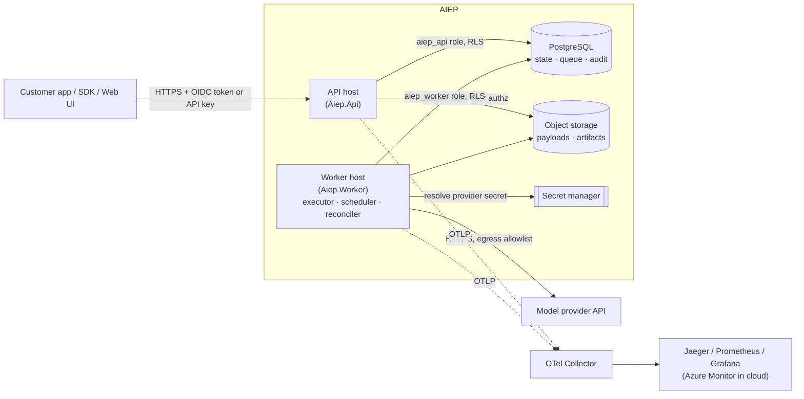

# Architecture overview

*Derived from Spec §5. Decisions: [ADR-0002](../adr/0002-modular-monolith-with-separate-worker.md),
[0004](../adr/0004-postgresql-system-of-record.md), [0005](../adr/0005-postgresql-backed-work-queue.md),
[0006](../adr/0006-tenant-isolation-shared-database-rls.md), [0012](../adr/0012-opentelemetry-observability.md).*

## System context

## Deployable units

| Unit | Runs | Identity | Scales on |
| --- | --- | --- | --- |
| API | Authentication, authorization, validation, quotas, run acceptance, reads | `aiep_api` database role; managed identity with Blob SAS-delegation rights | Request rate / CPU |
| Worker | Claim → execute → persist; retry scheduling; lease recovery; cleanup | `aiep_worker` database role; managed identity with Key Vault read for provider secrets | Queue depth / age |
| Migrator (job) | Applies SQL migrations | `aiep_migrator` (schema owner) | Runs once per release |
| Telemetry stack | Collect, store, visualize | — | — |

## Module map

Modules are namespaces inside the layered projects (ADR-0002).

| Module | Owns | Key concepts |
| --- | --- | --- |
| Tenancy | Organizations, workspaces, memberships, roles | Effective permissions ([ADR-0010](../adr/0010-two-level-role-model.md)) |
| Identity | Subjects, API keys, service accounts | Key verification, revocation |
| Definitions | Task definitions and immutable versions | Schemas, handler pinning, capabilities |
| Runs | Task runs, attempts, idempotency | [State machine](task-lifecycle.md) |
| Execution | Handler registry, executor, model adapters | Leases, budgets, output validation |
| Evaluation | Suites, datasets, scorers, reports | Versioned, reproducible comparisons |
| Usage | Quotas, rate limits, cost estimation | Reserve-then-settle accounting |
| Audit | Security-relevant event log | Append-only |

## Request path: submit a run

1. API authenticates the caller (OIDC token or API key).
2. Resolves the workspace from the path; loads it **with** tenant context; 404 if not visible.
3. Authorizes `runs:submit` on the workspace.
4. Validates the idempotency key, payload size, task-definition version and input schema.
5. Reserves quota (concurrency, budget).
6. In one transaction: insert run (`Queued`), attempt metadata, audit event (if relevant), and store `traceparent`.
7. `NOTIFY` workers; return `202 Accepted`.

## Execution path

1. Worker claims the next fair-share eligible run (`FOR UPDATE SKIP LOCKED`), sets the lease and creates an attempt.
2. Sets tenant context from the **claimed row**; loads authorized inputs.
3. Resolves the handler from the allowlist; applies the time and token budget.
4. Calls the provider through the adapter; validates output against the schema.
5. Writes the artifact under the tenant prefix; transitions to a terminal state or `RetryWait`; settles quota and cost.
6. Cleans up the per-run scratch directory and in-memory secrets.

## Cross-cutting rules

- PostgreSQL is authoritative; caches and queues are not.
- Every database access goes through one tenant-context unit of work ([ADR-0013](../adr/0013-data-access-and-migrations.md)).
- No payloads in telemetry; low-cardinality metric labels only.
- Model output is untrusted data.

## Open questions

- Object storage path layout and SAS policy (Phase 3).
- Whether evaluation runs share the worker pool or get a separate pool or priority lane (Phase 4; Spec §9.5).
