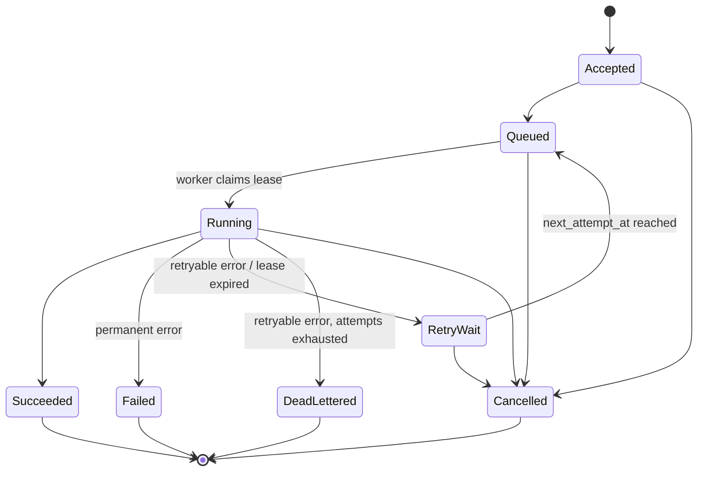

# Task run lifecycle and delivery contract

*Derived from Spec §9. Implemented in `src/Aiep.Domain/Runs/TaskRunTransitions.cs` and tested in
`tests/Aiep.Domain.Tests/TaskRunTransitionsTests.cs`. Keep this page and that table in sync.*

## State machine

| State | Meaning |
| --- | --- |
| `Accepted` | Durably recorded, not yet eligible (for example a deferred start). With ADR-0005 most runs go straight to `Queued` in the same transaction. |
| `Queued` | Eligible to be claimed once `next_attempt_at` has passed. |
| `Running` | Claimed by a worker holding an unexpired lease. Exactly one attempt is open. |
| `RetryWait` | Last attempt failed in a retryable way; waiting for backoff. |
| `Succeeded` | Handler completed and output passed schema validation. **Says nothing about semantic correctness.** |
| `Failed` | Permanent failure (invalid input discovered at execution, provider rejected request, output schema invalid after the allowed repair attempts). |
| `Cancelled` | Cancellation was accepted and the run will not produce a result. |
| `DeadLettered` | Retryable failures exhausted `max_attempts`. Inspectable; can be replayed into a **new** linked run. |

Rules:

- Only transitions in the table are legal. All status changes go through one domain method that checks the table and
  uses optimistic concurrency (`WHERE id = @id AND status = @expected`).
- Terminal states are final. A replay creates a new run with `replayed_from_run_id` (FR-015).
- Each attempt is a row in `task_run_attempts` (start, end, worker, outcome, error category, provider latency, usage).
  Retries add attempts; history is never overwritten (Spec §4.4).

## Delivery contract

We do **not** claim exactly-once execution. The precise contract is:

1. **Durable acceptance.** A `202` means the run row exists in committed state and will be processed or visibly
   tracked until terminal.
2. **At-least-once attempts.** A worker crash or lease expiry can cause the handler to run more than once for the same
   run, and the model provider may receive duplicate requests (and may bill for them).
3. **At most one terminal outcome per logical run.** The terminal transition is a conditional update. A late or
   duplicate attempt that loses the race discards its result.
4. **Idempotent submission.** The same `Idempotency-Key` with the same payload hash, within the same
   `(organization, workspace, caller)`, returns the same run. The same key with a different payload returns `409 idempotency.conflict`.
   Keys are kept for 24 h (configurable).
5. **Idempotent result persistence.** Artifacts are written to a deterministic path per `(run, attempt)`; only the
   winning attempt's artifact is linked to the run.

## Retries

- Retry only **retryable** categories: provider `RateLimited`, `Timeout`, `Transient` (5xx, network), and lease expiry.
- Never retry: validation, authorization, `InvalidRequest`, `ContentRefused`, output schema invalid (after repair).
- Backoff: `min(cap, base × 2^(attempt-1))` with full jitter; honour provider `Retry-After` when it is larger.
  Defaults: base 2 s, cap 5 min, `max_attempts` 3 (per task-definition version, with a platform maximum).

## Leases and recovery

- Claim (`claim_next_run`, V0003) picks one eligible run with `FOR UPDATE OF r SKIP LOCKED`. A due `RetryWait` run is
  promoted through `Queued` to `Running` in that one atomic claim (both legal transitions), rather than in a separate pass.
- Claim sets `lease_expires_at = now() + lease_duration` (default 60 s); the worker heartbeats every `lease_duration / 3`.
- Execution has a hard timeout from the task-definition version. The executor cancels the handler when it expires.
- The reconciler moves `Running` runs with expired leases to `RetryWait` (or `DeadLettered` if attempts are exhausted)
  and records the abandoned attempt as `LeaseExpired`.

## Cancellation

Cancellation has two parts, reported separately:

- `cancel_requested_at`: the platform accepted the request (API returns `202`).
- Actual stop: `Queued`/`RetryWait` → `Cancelled` immediately. For `Running`, the worker sees the flag at its next
  heartbeat, cancels the handler's `CancellationToken`, aborts the HTTP call if it can, discards output and moves to `Cancelled`.
- An in-flight provider request may still complete and be billed. The run detail shows `providerCallMayHaveCompleted: true`
  and we never claim the external call was cancelled (Spec §9.3).

## Open questions

- Should `Accepted` exist as a separate persisted state at all, given ADR-0005? (Keep it for scheduled and deferred runs; decide in Phase 2.)
- Output "repair" policy for invalid structured output: zero or one re-prompt attempts?
