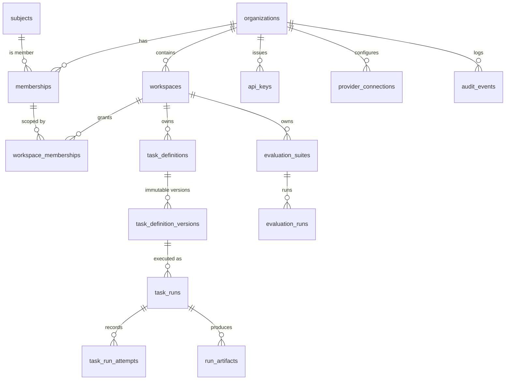

# Data model (v0.1)

*Derived from Spec §4, §13. Isolation enforcement per [ADR-0006](../adr/0006-tenant-isolation-shared-database-rls.md);
schema ownership per [ADR-0013](../adr/0013-data-access-and-migrations.md). Columns are indicative until each table's
migration lands.*

## Entity relationships



## Ownership rules

Every tenant-owned table has:

- `id uuid` (UUIDv7) primary key, exposed as a prefixed opaque string ([ADR-0015](../adr/0015-api-conventions.md)).
- `organization_id uuid NOT NULL`, plus `workspace_id uuid NOT NULL` for workspace-owned tables.
- `created_at timestamptz`, `created_by uuid` (subject or service identity), `updated_at` where mutable.
- RLS **enabled and forced**, with the tenant policy.
- A `UNIQUE (organization_id, id)` (and `(organization_id, workspace_id, id)` where relevant) so children can use
  **composite foreign keys**.

### Composite foreign key pattern

```sql
-- Parent exposes a composite key
ALTER TABLE workspaces ADD CONSTRAINT workspaces_org_id_uk UNIQUE (organization_id, id);

-- Child cannot point at a workspace in another organization
CREATE TABLE task_definitions (
    id               uuid PRIMARY KEY,
    organization_id  uuid NOT NULL,
    workspace_id     uuid NOT NULL,
    -- ...
    FOREIGN KEY (organization_id, workspace_id) REFERENCES workspaces (organization_id, id),
    UNIQUE (organization_id, workspace_id, id)
);

-- A run's definition version must be in the same org AND workspace
CREATE TABLE task_runs (
    id                          uuid PRIMARY KEY,
    organization_id             uuid NOT NULL,
    workspace_id                uuid NOT NULL,
    task_definition_version_id  uuid NOT NULL,
    -- ...
    FOREIGN KEY (organization_id, workspace_id, task_definition_version_id)
        REFERENCES task_definition_versions (organization_id, workspace_id, id)
);
```

### RLS policy pattern

```sql
ALTER TABLE task_runs ENABLE ROW LEVEL SECURITY;
ALTER TABLE task_runs FORCE ROW LEVEL SECURITY;

CREATE POLICY tenant_isolation ON task_runs
    USING      (organization_id = nullif(current_setting('app.organization_id', true), '')::uuid)
    WITH CHECK (organization_id = nullif(current_setting('app.organization_id', true), '')::uuid);
```

`nullif(..., '')` handles a setting that was reset to an empty string: it becomes NULL and matches nothing,
instead of raising a cast error.

## Core tables (summary)

| Table | Notes |
| --- | --- |
| `subjects` | Internal identity; `(issuer, external_sub)` unique. Not tenant-owned (a person can be in many orgs). |
| `organizations` | Status, quota policy, retention policy. RLS on `id`. |
| `memberships` | `(organization_id, subject_id)` unique; `org_role`; `status`. |
| `workspaces` | `slug` unique per organization; `status` (`active`, `archived`, `deleting`). |
| `workspace_memberships` | `(organization_id, workspace_id, subject_id)` unique; `workspace_role`. Composite FK to `memberships` with cascade delete. |
| `task_definitions` | Stable identity; `current_version`. |
| `task_definition_versions` | **Immutable** after publish (trigger blocks UPDATE once `published_at` is set). Input and output JSON Schema, `handler_type`, `handler_version`, model config, prompt template, limits, retry policy, capabilities. |
| `task_runs` | See Spec §13.2 plus `lease_owner`, `lease_expires_at`, `cancel_requested_at`, `traceparent`, `replayed_from_run_id`, `pricing_version`. Partial index on `(next_attempt_at) WHERE status IN ('Queued','RetryWait')`. |
| `task_run_attempts` | One row per attempt: timing, worker, outcome, error category, provider latency, usage. |
| `idempotency_keys` | `(organization_id, workspace_id, caller_id, key_hash)` unique → `run_id`, `request_hash`, `expires_at`. |
| `run_artifacts` | Kind (input/output/log), storage path, size, content hash, content type. |
| `api_keys` | `key_id` unique, `secret_hash`, owner, org, optional workspace, `permissions text[]`, `environment`, `expires_at`, `revoked_at`, `last_used_at`. |
| `provider_connections` | Provider, secret **reference** (Key Vault URI), allowed models. Never the secret. |
| `quota_reservations` | Reserve-then-settle ledger per run. |
| `evaluation_suites` / `_versions` / `evaluation_runs` / `evaluation_results` | Versioned datasets, scorer versions, per-example results. |
| `audit_events` | Append-only: actor, action, target, org, workspace, outcome, reason, correlation ID, timestamp. Services get INSERT/SELECT only. |
| `model_pricing` | Provider, model, `effective_from`, prices, source URL. Global (not tenant-owned). |

## Open questions

- Hard delete vs crypto-shredding for tenant deletion (Spec §15.4). Decide with the retention design in Phase 3.
- Partitioning `task_run_attempts` and `audit_events` by month: design it now, enable it later.
