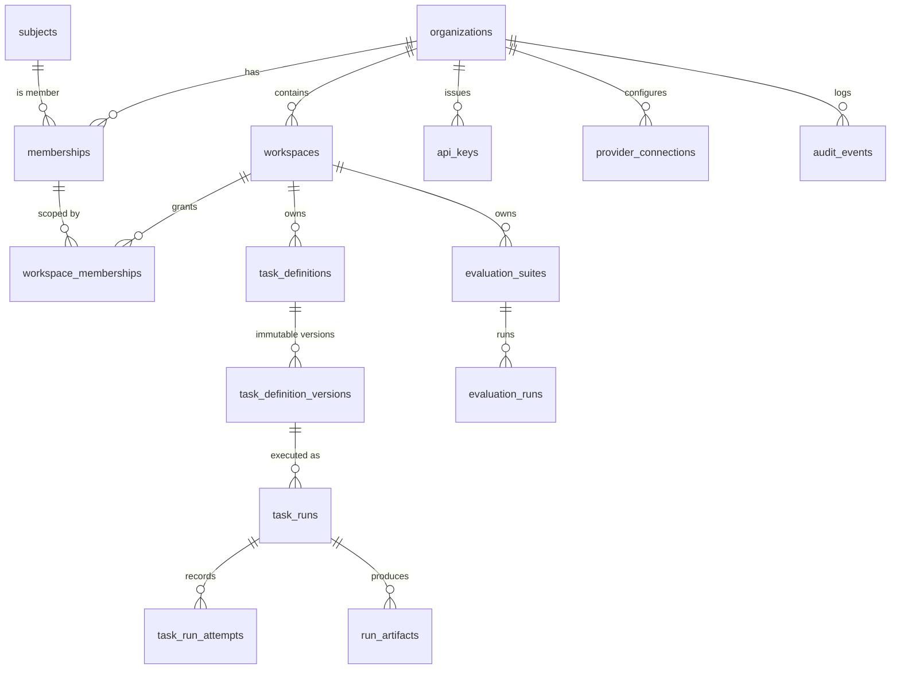

# Data model (v0.1)

*Derived from Spec §4, §13. Isolation enforcement per [ADR-0006](../adr/0006-tenant-isolation-shared-database-rls.md);
schema ownership per [ADR-0013](../adr/0013-data-access-and-migrations.md). Tables marked **built** exist in a
migration, and that SQL file is the canonical column list. The rest are indicative until their migration lands.*

## Entity relationships



## Ownership rules

Every tenant-owned table has:

- `id uuid` (UUIDv7) primary key, exposed as a prefixed opaque string ([ADR-0015](../adr/0015-api-conventions.md)).
- `organization_id uuid NOT NULL`, plus `workspace_id uuid NOT NULL` for workspace-owned tables.
- `created_at timestamptz`, `created_by uuid` (subject or service identity), `updated_at` where mutable.
- RLS **enabled and forced**, with the tenant policy.
- A `UNIQUE (organization_id, id)` (and `(organization_id, workspace_id, id)` where relevant) so children can use
  **composite foreign keys**.

### Composite foreign key pattern

```sql
-- Parent exposes a composite key
ALTER TABLE workspaces ADD CONSTRAINT workspaces_org_id_uk UNIQUE (organization_id, id);

-- Child cannot point at a workspace in another organization
CREATE TABLE task_definitions (
    id               uuid PRIMARY KEY,
    organization_id  uuid NOT NULL,
    workspace_id     uuid NOT NULL,
    -- ...
    FOREIGN KEY (organization_id, workspace_id) REFERENCES workspaces (organization_id, id),
    UNIQUE (organization_id, workspace_id, id)
);

-- A run's definition version must be in the same org AND workspace
CREATE TABLE task_runs (
    id                          uuid PRIMARY KEY,
    organization_id             uuid NOT NULL,
    workspace_id                uuid NOT NULL,
    task_definition_version_id  uuid NOT NULL,
    -- ...
    FOREIGN KEY (organization_id, workspace_id, task_definition_version_id)
        REFERENCES task_definition_versions (organization_id, workspace_id, id)
);
```

### RLS policy pattern

```sql
ALTER TABLE task_runs ENABLE ROW LEVEL SECURITY;
ALTER TABLE task_runs FORCE ROW LEVEL SECURITY;

CREATE POLICY tenant_isolation ON task_runs
    USING      (organization_id = nullif(current_setting('app.organization_id', true), '')::uuid)
    WITH CHECK (organization_id = nullif(current_setting('app.organization_id', true), '')::uuid);
```

`nullif(..., '')` handles a setting that was reset to an empty string: it becomes NULL and matches nothing,
instead of raising a cast error.

## Built so far

| Migration | Tables |
| --- | --- |
| [`V0001__tenancy_baseline.sql`](../../db/migrations/V0001__tenancy_baseline.sql) | `subjects`, `organizations`, `memberships`, `workspaces`, `workspace_memberships`, `api_keys`, `audit_events` |
| [`V0002__task_execution.sql`](../../db/migrations/V0002__task_execution.sql) | `task_definitions`, `task_definition_versions`, `task_runs`, `task_run_attempts`, `idempotency_keys` |

`aiep.schema_migrations` (version, name, checksum, applied time) is created by `Aiep.Migrator` itself and is readable
only by `aiep_migrator`.

### Service-role privileges (V0001)

The init script grants SELECT/INSERT/UPDATE/DELETE on every new table to both service roles; V0001 narrows that.

| Table | `aiep_api` | `aiep_worker` | Notes |
| --- | --- | --- | --- |
| `subjects` | SELECT | SELECT | Visible: yourself and co-members of the current org. Writes only through `resolve_subject` ([ADR-0017](../adr/0017-pre-tenant-operations-security-definer.md)) |
| `organizations` | SELECT, UPDATE | SELECT | Created only through `create_organization`; no DELETE until tenant deletion is designed |
| `memberships`, `workspace_memberships` | full DML | SELECT | Grants cascade-delete with their membership |
| `workspaces` | SELECT, INSERT, UPDATE | SELECT | Archive is a status change |
| `api_keys` | SELECT, INSERT, UPDATE | SELECT | Revocation is `revoked_at`; pre-tenant lookup through `find_api_key` |
| `audit_events` | SELECT, INSERT | SELECT, INSERT | Plus a trigger that blocks UPDATE/DELETE for everyone |

### Service-role privileges (V0002)

Both services keep SELECT on every task-execution table (the no-context isolation test reads each table as each role).
Nothing here is ever deleted by a service.

| Table | `aiep_api` | `aiep_worker` | Notes |
| --- | --- | --- | --- |
| `task_definitions` | SELECT, INSERT, UPDATE | SELECT | API authors; worker reads the handler config. Archive is a status change |
| `task_definition_versions` | SELECT, INSERT, UPDATE | SELECT | UPDATE is for the draft → publish transition; a trigger blocks any UPDATE once published |
| `task_runs` | SELECT, INSERT, UPDATE | SELECT, UPDATE | API submits and cancels; worker claims, heartbeats and finishes. No service INSERT for the worker |
| `task_run_attempts` | SELECT | SELECT, INSERT, UPDATE | Written only by the worker; the API reads attempt history |
| `idempotency_keys` | SELECT, INSERT | SELECT | API records and looks up; worker does not use them |

### Choices made while building V0001

- **IDs are generated by the application** (UUIDv7, `Guid.CreateVersion7`); PostgreSQL 17 has no `uuidv7()`.
- **`api_keys.owner_subject_id` references `subjects`, not `memberships`.** Removing a member must not be blocked by
  their keys; the key's permissions are re-checked against the owner's current memberships on every use (ADR-0008).
- **`api_keys.key_id` is globally unique**, because it is looked up before the tenant is known.
- **`audit_events.workspace_id` and `target_id` have no foreign keys**, because audit records must outlive what they describe.
  There is no free-form payload column, so nothing sensitive can be audited by accident.
- **`organizations` has no slug.** A globally unique slug would reveal which names other tenants use.
- **Workspace slugs** are lowercase DNS-label style (`^[a-z0-9]([a-z0-9-]{0,61}[a-z0-9])?$`), unique per organization.

### Choices made while building V0002 (Phase 2)

- **Status and queue state live on `task_runs`, not a separate queue table** (ADR-0005). There is no outbox for dispatch:
  a run is enqueued by being inserted `Queued` in the same transaction as acceptance.
- **`input` and `output` are stored inline as `jsonb`** for the MVP. `run_artifacts` / blob storage (large payloads, logs)
  is a later phase; the column list here stays honest about what exists.
- **`error_message` is a short, non-sensitive summary only** (≤ 2000 chars, `CHECK`). Prompts, model outputs and secrets
  never go in it (CLAUDE.md, ADR-0012); the full input/output are the `input`/`output` columns, not the error.
- **Task-definition versions are created as a `draft`, then `published`.** A `BEFORE UPDATE` trigger raises once
  `published_at` is set, so a published version is immutable; the publishing UPDATE itself is allowed because
  `OLD.published_at` is still NULL at that point. (Same shape as the `audit_events` append-only trigger: a plain,
  non-`SECURITY DEFINER` trigger function, so no pinned `search_path` is required.)
- **`idempotency_keys.caller_id`** is the submitting subject id (user) or API-key id (application); the two id spaces are
  distinct UUIDv7 values, so a single column disambiguates callers without a `caller_type`.
- **The worker never INSERTs `task_runs`** (only the API submits) and **never writes definitions**; it has UPDATE on
  `task_runs` for claim/heartbeat/finish and INSERT/UPDATE on `task_run_attempts`. Attempts are worker-only.

## How services reach tenant data

One path only: [`TenantDatabase.ExecuteAsync`](../../src/Aiep.Infrastructure/Persistence/TenantDatabase.cs)
([ADR-0006](../adr/0006-tenant-isolation-shared-database-rls.md), [ADR-0013](../adr/0013-data-access-and-migrations.md)).

```csharp
var workspaces = await tenantDatabase.ExecuteAsync(
    TenantContext.ForOrganization(orgId, subjectId),          // from authentication or a claimed run row
    (session, ct) => session.Db.Workspaces.ToListAsync(ct));
```

Each call takes a pooled connection, begins a transaction, runs
`set_config('app.organization_id', …, true), set_config('app.subject_id', …, true)`, gives the callback an EF Core
`AiepDbContext` bound to that connection and transaction, saves pending changes and commits. Any exception rolls back.

- **Nothing else is reachable.** `NpgsqlDataSource` and `AiepDbContext` aren't registered in DI, and their
  constructors aren't public. Raw Npgsql (hot paths, `SECURITY DEFINER` calls) uses the session's connection from
  inside `Aiep.Infrastructure`.
- **Two independent reasons a tenant setting can't leak through the pool:** the settings are transaction-local, and
  Npgsql resets session state (`DISCARD ALL`) when a connection returns to the pool. Tests pin each one separately.
- **EF mappings mirror the SQL schema**, with snake_case columns and no EF migrations. A test compares every mapped
  table's columns and nullability with `information_schema`, so drift fails CI.

## Core tables (summary)

| Table | Notes |
| --- | --- |
| `subjects` | **Built.** Internal identity; `(issuer, external_subject)` unique. Not tenant-owned (a person can be in many orgs). RLS: self and co-members only. |
| `organizations` | **Built** (name, status). Quota and retention policy columns come with their phases. RLS on `id`. |
| `memberships` | **Built.** `(organization_id, subject_id)` unique; `org_role`; `status` (`active`, `suspended`). |
| `workspaces` | **Built.** `slug` unique per organization; `status` (`active`, `archived`, `deleting`); `archived_at` set iff archived. |
| `workspace_memberships` | **Built.** `(organization_id, workspace_id, subject_id)` unique; `workspace_role`. Composite FK to `memberships` with cascade delete. |
| `task_definitions` | **Built.** Workspace-owned; `slug` unique per workspace; `current_version` points at the latest published version number; `status` (`active`, `archived`). |
| `task_definition_versions` | **Built.** **Immutable** after publish (trigger blocks UPDATE once `published_at` is set). Input and output JSON Schema, `handler_type`/`handler_version` (allowlisted, ADR-0007), `model_provider`/`model_name`/`model_config`, prompt template, and the `max_attempts`/`timeout_seconds`/`lease_seconds` limits. |
| `task_runs` | **Built.** Status + `next_attempt_at` + `lease_owner`/`lease_expires_at` **are** the queue (ADR-0005). Plus `attempt_count`, `max_attempts`, inline `input`/`output` jsonb, `error_category`/`error_message`, `cancel_requested_at`, `provider_call_may_have_completed`, `traceparent`, `replayed_from_run_id`. Partial indexes on `(next_attempt_at) WHERE status IN ('Queued','RetryWait')` and `(lease_expires_at) WHERE status = 'Running'`. `pricing_version` comes with Phase 4. |
| `task_run_attempts` | **Built.** One row per attempt, never overwritten: `attempt_number`, `worker_id`, `status`, timing, error category, provider latency, token usage. |
| `idempotency_keys` | **Built.** `(organization_id, workspace_id, caller_id, key_hash)` unique → `run_id`, `request_hash`, `expires_at`. |
| `run_artifacts` | Kind (input/output/log), storage path, size, content hash, content type. |
| `api_keys` | **Built.** `key_id` unique, `secret_hash` (32 bytes), owner, org, optional workspace, `permissions text[]`, `environment`, `expires_at`, `revoked_at`, `last_used_at`. |
| `provider_connections` | Provider, secret **reference** (Key Vault URI), allowed models. Never the secret. |
| `quota_reservations` | Reserve-then-settle ledger per run. |
| `evaluation_suites` / `_versions` / `evaluation_runs` / `evaluation_results` | Versioned datasets, scorer versions, per-example results. |
| `audit_events` | **Built.** Append-only: actor, action, target, org, workspace, outcome, reason, correlation ID, timestamp. Services get INSERT/SELECT only; a trigger blocks UPDATE/DELETE. |
| `model_pricing` | Provider, model, `effective_from`, prices, source URL. Global (not tenant-owned). |

## Open questions

- Hard delete vs crypto-shredding for tenant deletion (Spec §15.4). Decide with the retention design in Phase 3.
- Partitioning `task_run_attempts` and `audit_events` by month: design it now, enable it later.
