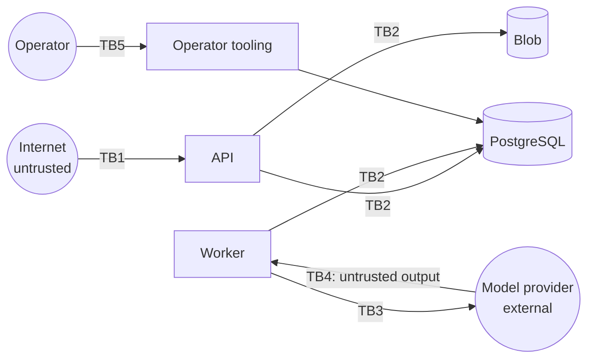

# Threat model (v0.1, Phase 0)

*Derived from Spec §6, §7, §15, §20. Revisit at the end of every phase and whenever a trust boundary changes.*

## Scope

MVP architecture: API host, worker host, PostgreSQL, object storage, secret manager, one external model provider,
telemetry stack. Trusted, allowlisted handlers only ([ADR-0007](../adr/0007-trusted-allowlisted-handlers-only.md)).

## Assets (by impact if compromised)

| Asset | Why it matters |
| --- | --- |
| Tenant task inputs/outputs, datasets, artifacts | Customer confidential data; cross-tenant exposure is the worst-case incident |
| Provider credentials | Direct financial loss; abuse attributed to us |
| API keys and sessions | Impersonation of a tenant's applications or users |
| Authorization data (memberships, roles, key scopes) | Tampering gives privilege escalation |
| Audit events | Integrity is needed for investigations |
| Quotas and billing data | Budget bypass leads to unbounded spend |
| Platform availability | Noisy neighbours, DoS |

## Trust boundaries

TB1: public API. TB2: services to data (database roles, RLS, storage identity). TB3: outbound to provider.
TB4: model output re-entering the system. TB5: privileged human access.

## Threats and mitigations (STRIDE)

| # | Threat | Boundary | Mitigation | Verified by |
| --- | --- | --- | --- | --- |
| T1 | **Cross-tenant read through IDOR / guessed IDs** | TB1/TB2 | Opaque IDs; authorization on resolved ownership; 404 concealment; RLS; composite FKs | DB layer: `TenantIsolationTests` (cross-tenant read/update/insert/move, composite FKs). API layer: negative isolation suite (Spec §6.5), Phase 1 step 7 |
| T2 | **Tenant context leak across pooled connections** | TB2 | `SET LOCAL` in transaction only; single unit-of-work path | `TenantDatabaseTests.Pool_of_one_alternating_tenants_never_carries_context_over`, `…Pool_of_one_a_failed_unit_of_work_leaves_no_context_behind`, `…Tenant_settings_are_transaction_local_on_the_same_connection` (mutation-checked), `…Pool_of_one_the_connection_carries_no_tenant_setting_after_a_unit_of_work`, `TenantIsolationTests.Tenant_context_does_not_outlive_its_transaction_on_a_reused_connection` |
| T3 | Missing tenant context returns rows | TB2 | Policies compare to `current_setting(..., true)`; NULL matches nothing | `TenantIsolationTests.Without_tenant_context_every_tenant_table_returns_no_rows` (catalog-driven, every tenant table, both service roles) |
| T4 | Spoofed tenant in body or queue payload | TB1 | Scope derived from auth and resource rows only; worker uses claimed row | Tests posting a foreign `organizationId` |
| T5 | Stolen or leaked API key | TB1 | Prefix for leak scanning; hashed at rest; scoped; expiry; instant revocation; `last_used_at` | Revoked/expired key tests |
| T6 | Privilege escalation through role or key management | TB1 | Key scope ⊆ creator permissions, re-checked on use; only Owner can grant Owner; audited | Escalation tests |
| T7 | **Prompt injection causing data access or actions** | TB4 | Authorization outside the model; handlers have no tools in the MVP; output validated as data | Injection fixtures in the handler test suite |
| T8 | Malicious output (XSS in UI, CSV injection in exports) | TB4 | Output treated as untrusted; encode in UI; escape exports | UI and export tests |
| T9 | SSRF through user-supplied URLs | TB1/TB3 | MVP accepts no fetch URLs; worker egress allowlist; metadata endpoint blocked | Network policy check; future webhook tests |
| T10 | Provider credential exfiltration | TB3 | Key Vault plus managed identity; worker-only read; never logged; egress allowlist | Log scanning test for secret patterns |
| T11 | Payload leakage in logs/traces | all | No payloads by default; redaction; access-controlled telemetry | Telemetry review checklist; automated log grep in CI |
| T12 | Spend exhaustion / noisy neighbour | TB1 | Reserve-then-settle quotas; per-org and per-workspace concurrency; fair claim; payload limits; 429 | Load test with one abusive tenant |
| T13 | Duplicate execution doubles cost or side effects | TB3 | Delivery contract; idempotent persistence; provider idempotency keys where supported | Duplicate-delivery fault injection |
| T14 | Operator over-access to tenant data | TB5 | No standing access; time-bound break-glass; audited | Audit event tests |
| T15 | Audit log tampering | TB2 | Services have INSERT/SELECT only on `audit_events`; later hash chaining | `PrivilegeAndBootstrapTests.Services_cannot_update_or_delete_audit_events`, `…Even_the_owner_cannot_update_audit_events_because_of_the_trigger` |
| T16 | Supply-chain compromise | build | Pinned packages and images; Dependabot; image scanning; SBOM | CI |
| T17 | Staging/production credential crossover | env | Environment-prefixed keys; separate identities and resources | Key-environment test |

## Accepted risks (MVP)

- Shared PostgreSQL cluster: a database engine vulnerability could cross tenants. Accepted for the MVP (ADR-0006).
- Shared worker process: a handler bug could expose another run's in-memory data. Mitigated by trusted code and
  per-run contexts; accepted (ADR-0007).
- Duplicate provider calls may be billed (task lifecycle contract).

## Open questions

- Payload capture for debugging: opt-in per workspace with retention? (Phase 3)
- Tamper-evident audit storage (hash chain or immutable blob) before production?
